<p align="center">
  
</p>

<p align="center">
  <a href="https://github.com/danjdewhurst/bugsweep/actions/workflows/ci.yml"></a>
  <a href="https://github.com/danjdewhurst/bugsweep/releases/latest"></a>
  <a href="LICENSE"></a>
  
  <a href="https://skills.sh/danjdewhurst/bugsweep"></a>
</p>

<p align="center">
  <a href="#install">Install</a> ·
  <a href="#use">Use</a> ·
  <a href="#what-it-cannot-do">Limits</a> ·
  <a href="#signatures">Signatures</a> ·
  <a href="#agent-skills">Agent skills</a> ·
  <a href="CONTRIBUTING.md">Contribute</a>
</p>

---

**bugsweep** checks the radio around you for things that can track, film or
record you: location trackers, smart glasses, AI recorder pendants, cameras
and body cameras. It runs on an ordinary laptop, with no extra hardware, and
keeps everything on your machine.

| | It finds | How |
|---|---|---|
| 📡 | **Trackers**: AirTag, Find My tags, Samsung SmartTag, Tile, Chipolo, Pebblebee, Google Find Hub and DULT tags | Bluetooth LE frames, with the "away from its owner" state |
| 🕶️ | **Smart glasses**: Ray-Ban and Oakley Meta, Even Realities, Brilliant Labs, Rokid, Mentra and more | Company IDs, services and names |
| 🎙️ | **AI recorders**: Plaud, Limitless, Bee, Friend, Omi and more | Company IDs, services and names |
| 📹 | **Cameras and body cams**: IP cameras, NVRs, GoPro, DJI, Insta360, Axon, WatchGuard | Bluetooth, ONVIF, RTSP, camera ports and adapter makers |
| 🚶 | **Followers**: a device that turns up at two or more of your places | A local log of sightings |

bugsweep does four jobs with one signature database:

1. **Room sweep.** It scans Bluetooth LE and classifies each device. A finder
   screen shows the signal of one device so you can walk towards it.
2. **Recorder alert.** Smart glasses, voice recorders and trackers that are
   away from their owner show at the top of the list.
3. **Follower check.** A local log records where each device was seen. A
   device that turns up at two or more places is flagged.
4. **Network camera sweep.** It looks for IP cameras and video recorders on
   the local network (ONVIF discovery, RTSP, vendor ports, and the maker of
   each network adapter).

## Install

**Linux and macOS** (x86_64 and Apple silicon / arm64):

```sh
curl -fsSL https://raw.githubusercontent.com/danjdewhurst/bugsweep/main/install.sh | bash
```

The script picks the right build for your system, checks its SHA-256 sum and
installs `bugsweep` to `~/.local/bin`. The Linux builds need glibc 2.35 or
later (Ubuntu 22.04, Debian 12, Fedora 36 or newer). Options:

```sh
# a specific version, into another directory
curl -fsSL https://raw.githubusercontent.com/danjdewhurst/bugsweep/main/install.sh | bash -s -- --version v0.1.0 --dir ~/bin

# for all users (needs sudo)
curl -fsSL https://raw.githubusercontent.com/danjdewhurst/bugsweep/main/install.sh | sudo bash -s -- --dir /usr/local/bin
```

**Windows**: download `bugsweep-x86_64-pc-windows-msvc.zip` from the
[latest release](https://github.com/danjdewhurst/bugsweep/releases/latest).

**From source** (Rust 1.89 or later; on Linux, first install `libdbus-1-dev`
and `pkg-config`):

```sh
cargo install --locked --git https://github.com/danjdewhurst/bugsweep
```

Each release archive has a `.sha256` file and a
[build provenance attestation](https://docs.github.com/en/actions/security-for-github-actions/using-artifact-attestations).
Check one with `gh attestation verify <archive> --repo danjdewhurst/bugsweep`.

## What it cannot do

**This is a radio check, not proof that a room is clean.** bugsweep cannot see:

- a recorder or camera that only saves to a memory card,
- a wired camera, or a camera on a different network,
- a GSM/LTE bug,
- a device whose Bluetooth is off,
- smart glasses that are already connected to their phone. Meta glasses
  advertise only at power-on, pairing or reconnect.

Many signatures are heuristics. The details pane shows the confidence, the
kind of evidence and the source of each finding. A finding means "look at
this", not "this is a bug".

> [!IMPORTANT]
> If you think that someone tracks you, your safety comes first. Contact local
> police or a domestic-abuse support service. Record what you find before you
> remove or disable a tracker.

## Use

```sh
bugsweep                     # terminal interface
bugsweep scan                # scan for 15 s and print a table
bugsweep scan --json --seconds 30
bugsweep scan --flagged      # only devices that need attention
bugsweep lan                 # network camera sweep
bugsweep lan --all           # also list hosts without camera evidence
bugsweep followers           # devices seen at two or more places
bugsweep signatures          # list the signature database
```

Global options: `--place NAME`, `--signatures FILE`, `--db FILE`, `--no-log`.

Keys in the terminal interface:

| Key | Action |
|---|---|
| `↑` `↓` / `j` `k` | select a device |
| `f` or `Enter` | finder for the selected device |
| `m` | mark the device as known (yours), or remove the mark |
| `a` | show all devices, or only flagged devices (Bluetooth view); show all hosts (network view) |
| `Tab`, `1` `2` `3` | change the view |
| `l` | start the network sweep (network view only) |
| `q` | quit |

The network sweep sends connection attempts to each address of the local
network. Run it only on a network where you are allowed to do that.

The sweep reports a host as a camera when it answers ONVIF discovery, answers
RTSP, has a camera-specific port open, or has a network adapter from a camera
maker. The last test also finds cloud cameras, which have no open ports. It
cannot find a camera that uses a general-purpose Wi-Fi chip and opens no
ports; `lan --all` lists every host with its vendor so you can check by hand.

## Places and the follower check

A laptop has no GPS. By default the place is a key made from the MAC address
of the default gateway, so each network is one place. Give a name with
`--place hotel-rome` when you want a readable one, or when there is no network.

The log is a SQLite file in the user data directory
(`~/Library/Application Support/bugsweep/bugsweep.db` on macOS). It never
leaves the machine. Sightings older than 90 days are deleted. Mark your own
devices with `m`, or they show as followers.

Most devices change their Bluetooth address every few minutes, and the
platform ID changes with it. bugsweep therefore keeps more than one identity
key for each device and reports which kind of key matched:

| Match | Key | Strength |
|---|---|---|
| same ID | the platform ID | Exact, but it changes with the address. |
| same tracker key | the public key or ID in a Find My, Find Hub or SmartTag frame | Exact. Stays for about 24 hours while the tracker is away from its owner. |
| same name | the advertised name | Two devices of the same model can have the same name. |
| same data | a payload that did not change for 60 seconds | Weakest. Two devices of the same model can send the same data. Shown at level "low". |

Limits: a tracker changes its key about once a day, by design, so no tool can
link it from one day to the next. A device that sends no name and changes its
payload cannot be followed across an address change.

## Signatures

The database is `data/signatures.toml`. The format is described at the top of
that file. Each signature has a severity, a confidence, a source and a kind of
evidence:

| Evidence | Meaning |
|---|---|
| `spec` | official specification, or the vendor's own source code or firmware |
| `research` | paper or published capture from a real device |
| `code` | source code of another client or detector |
| `registry` | the ID is registered to the vendor, but its use in advertisements is not proven |
| `guess` | name pattern or assumption |

A specific signature can list less specific ones in `overrides`. When both
match, only the specific one is reported. Additions are welcome, most of all
rules that were confirmed against a real device.

Test a signature file without a rebuild:

```sh
cargo run -- --signatures my-signatures.toml scan
```

Vendor names come from the public Bluetooth SIG assigned numbers and the IEEE
registry of MAC address prefixes. Refresh them with `scripts/update-vendors.sh`.

## Agent skills

bugsweep ships [agent skills](https://skills.sh/danjdewhurst/bugsweep) so a
coding agent (Claude Code, Codex, Cursor, OpenCode and others) knows how to run
the CLI and read its output:

| Skill | What the agent learns |
|---|---|
| [`bugsweep`](skills/bugsweep/SKILL.md) | install bugsweep, run a sweep with `--json`, read the results, and report them with their limits |
| [`bugsweep-signatures`](skills/bugsweep-signatures/SKILL.md) | write, test and contribute a signature from a Bluetooth capture |

Install them with [skills.sh](https://skills.sh) (needs Node.js):

```sh
npx skills add danjdewhurst/bugsweep                        # both skills, this project
npx skills add danjdewhurst/bugsweep --skill bugsweep -g    # one skill, all projects
npx skills add danjdewhurst/bugsweep -a claude-code         # one agent only
```

Then ask your agent, for example: "Sweep this room for trackers and hidden
cameras."

## Platform notes

- **macOS**: the terminal app needs the Bluetooth permission (System Settings
  → Privacy & Security → Bluetooth). macOS hides MAC addresses, so rules with
  `address_prefix` do not work there.
- **Linux**: needs BlueZ. Gives MAC addresses.
- **Windows**: should work through WinRT. Not tested yet.

## Development

```sh
cargo fmt --all                          # format
cargo clippy --all-targets -- -D warnings  # lint
cargo test                               # unit and CLI tests (no Bluetooth needed)
bash tests/install.sh                    # test install.sh against a fake release
```

On Linux, the build needs `libdbus-1-dev` and `pkg-config`. CI runs the checks
above on Linux, macOS and Windows, plus the minimum Rust version, ShellCheck,
and [cargo-deny](https://github.com/EmbarkStudios/cargo-deny) for licences and
advisories.

### Releases

Versions follow [Semantic Versioning](https://semver.org/). Commit messages on
`main` follow [Conventional Commits](https://www.conventionalcommits.org/)
(`feat:`, `fix:`, `docs:` …). [release-please](https://github.com/googleapis/release-please)
turns them into a release PR that bumps the version and updates
[CHANGELOG.md](CHANGELOG.md). Merging that PR tags the release, and the
release workflow builds and uploads the binaries.

## Code map

| File | Job |
|---|---|
| `src/ble.rs` | Bluetooth LE scan (btleplug) |
| `src/signatures.rs` | signature database and matcher |
| `src/session.rs` | live device list, levels, link to the log |
| `src/identity.rs` | identity keys that survive an address change |
| `src/store.rs` | SQLite log, known devices, followers |
| `src/place.rs` | place key from the default gateway |
| `src/lan.rs` | network camera sweep |
| `src/tui.rs` | terminal interface (ratatui) |
| `src/vendors.rs` | company, service-UUID and MAC-prefix owner names |

## Credits

The signatures build on public work by many people, most of all
[AirGuard](https://github.com/seemoo-lab/AirGuard) (SEEMOO, TU Darmstadt), the
Apple Find My and Google Find Hub specifications, the IETF
[DULT](https://datatracker.ietf.org/wg/dult/about/) drafts,
[Omi](https://github.com/BasedHardware/omi),
[all-cameras-are-beacons](https://github.com/soyboi1312/all-cameras-are-beacons)
and [flock-you](https://github.com/colonelpanichacks/flock-you). The `source`
field of each signature names its origin. Vendor names come from the Bluetooth
SIG assigned numbers and the IEEE MA-L registry.

## Licence

[MIT](LICENSE) © Dan Dewhurst
